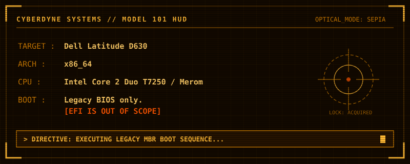

# T-800 // ALPINE-D630 BUILD DIRECTIVE
   

## 00 // TARGET MATRIX

| Subsystem | Required state |
|---|---|
| Alpine | 3.24.4 |
| aports | `3.24-stable`, pinned in `config/target.env` |
| Kernel | `linux-d630`, Linux 6.1.192 |
| Kernel baseline | `config/config-6.1.190-d630-core2` |
| CPU tuning | `CONFIG_MCORE2=y`; `-march=core2 -mtune=core2` |
| Rust tuning | `-C target-cpu=core2` |
| Graphics | Intel GM965 / GMA X3100; Crocus + Softpipe target |
| Display server | Xorg; DRI3 enabled |
| Boot chain | GRUB, BIOS El Torito |
| Image | Custom `d630` profile |

Alpine's stock `linux-lts` follows a different kernel line. This project builds a separate 6.1.192 kernel package. The custom userland APKs are compiled for Core 2. Builder-host utilities are not target binaries. Packages outside the custom build set may remain upstream Alpine binaries.

## 01 // SOURCE MAP

This repository stores source, configuration and build logic.

- `config/` — target contract, kernel configuration and build settings.
- `packaging/linux-d630/` — standalone Alpine kernel APKBUILD.
- `container/` — builder image and mkimage profile.
- `scripts/` — package, kernel, ISO and configuration-audit scripts.
- `.github/workflows/` — manual and release-tag build workflow.

Generated state is external to the checkout. Default build root:

- Workstation: `$HOME/.cache/alpine-d630/`
- GitHub Actions: `$RUNNER_TEMP/alpine-d630/`
- Override: `ALPINE_D630_BUILD_ROOT`

Build-root layout:

```text
aports/     pinned Alpine package sources
work/       downloaded source and build cache
packages/   staged APKBUILDs and signed APK repository
keys/       local abuild signing keys
output/     ISO images and checksums
```

Generated trees and private signing keys MUST NOT enter Git.

## 02 // KERNEL BUILD

REQUIREMENTS: Docker, Git, network access.

```sh
git clone https://github.com/AmrUser-48/alpine-d630.git
cd alpine-d630
./scripts/build-linux-d630.sh
```

The build fetches Linux 6.1.192 and its stable patch, applies the D630 configuration, runs `olddefconfig`, audits the result, compiles and emits signed APKs.

Firmware is supplied by Alpine binary packages:
- `intel-ucode` — early CPU microcode.
- `linux-firmware-intel` — Intel wireless firmware.

The kernel does not embed duplicate firmware. The package provides the iwl3945 firmware path expected by the driver and enables compressed-ZSTD firmware loading.

The source config remains unchanged. Preparation edits only the staged copy: disables unrelated drivers and embedded firmware, limits the system to two logical CPUs, and selects ZSTD as the zram default. The audit checks CPU target, required D630 drivers, filesystems, microcode and zram.

## 03 // CORE 2 USERLAND

```sh
./scripts/build-core2-userland.sh
```

Target APKs are rebuilt from the pinned aports tree with:

```text
CFLAGS/CXXFLAGS: -O2 -march=core2 -mtune=core2
RUSTFLAGS:       -C target-cpu=core2
```

APK release numbers are raised so the local Core 2 repository takes precedence over generic Alpine packages.

Core target set: musl, BusyBox, apk-tools, OpenRC, OpenSSL, OpenSSH, Bash, binutils, sed, ripgrep, fd, fzf, Neovim, Python, LuaJIT, lf, bat, Mesa, Xorg, Intel video DDX, libinput and Synaptics input drivers, xterm/xrdb, ALSA, SoX, LAME, networking and filesystem tools, PCI/USB tools, htop, zstd and xz.

The D630 toolchain also builds `dmenu`, `st`, and `dwm`. The Go `lf` build is pinned to `GOAMD64=v1`, safe for Merom without SSE4.1. Data-only packages such as `font-terminus`, `tzdata`, and `alsa-ucm-conf` come from the pinned Alpine repository.

Audio uses the kernel's Intel HDA driver and direct ALSA. PipeWire is intentionally omitted: this DWM/CLI live image does not require a user-session audio server.

Graphics constraints:
- Mesa without LLVM.
- No Vulkan, Rusticl or VA-API.
- Crocus for GM965/X3100; Softpipe software fallback.
- Xorg DRI3 enabled.
- Intel DDX: SNA default; UXA fallback.

DRI3 is an Xorg/Mesa capability, not a standalone APK target. The protocol definitions come from `xorgproto`; the server is built with DRI3 support.

## 03A // LIVE SESSION

- User: `d630` (UID/GID 1000); automatic login on tty1. TTY2–TTY6 retain normal login.
- Groups: `audio`, `video`, `input`, `wheel`, `netdev`, `dialout`, `lp`, `cdrom`, and `users`.
- `doas`: passwordless for `wheel` in this volatile live image.
- Shell: Bash, Neovim editor, history, bracketed paste, lf on Ctrl+O, and the Readline-safe command timer from `deb12dots`.
- X11: run `startx`; it starts dwm. Xterm uses Terminus through `.Xresources`. Alt+Shift switches US/Ukrainian layouts.
- Locale/time: `uk_UA.UTF-8` via `musl-locales`, timezone `Europe/Kyiv`.
- Console: Terminus `ter-116n.psf.gz`, loaded by OpenRC at boot. ALSA mixer state is restored/saved by OpenRC.

All live changes are ephemeral unless written to persistent storage.

A package is COMPLETE only when its APK is present, its metadata and signing verify, and the local repository index is regenerated. A successful compiler invocation alone is not a release.

## 04 // BIOS IMAGE

```sh
./scripts/build-d630-iso.sh
ls -lh "$HOME/.cache/alpine-d630/output"
```

The `d630` profile combines the custom kernel, Core 2 local APK repository, Intel firmware and CPU microcode. It excludes the upstream extended profile's unrelated ZFS and xtables kernel set.

Boot contract: legacy BIOS + GRUB. EFI artifacts are not required.

## 05 // AUTOMATION

GitHub Actions entry point:

`Actions → Build Alpine for Dell Latitude D630 → Run workflow`

The workflow checks out this repository, retrieves pinned aports, builds the kernel and ISO, then publishes the ISO and `SHA256SUMS`. Tags matching `alpine-d630-*` also trigger a build. Artifacts are retained for 14 days.

## 06 // ACCEPTANCE TEST

BUILD SUCCESS ≠ HARDWARE VALIDATION.

Required physical D630 tests:
- BIOS/GRUB boot and root filesystem.
- SATA, Intel graphics and DRI3.
- iwl3945 Wi-Fi, audio, touchpad and pointing stick.
- CPU frequency scaling and thermal behavior.
- ext4/NTFS, zram and suspend/resume.

Retain a known-good boot entry until every critical test passes.

## 99 // EXECUTION RULES

1. Preserve the pinned Alpine source revision.
2. Compile target binaries for Core 2. Do not substitute generic APKs for requested custom builds.
3. Keep LLVM disabled. Resolve Mesa configuration conflicts; do not silently enable LLVM.
4. Keep EFI out of the boot design.
5. Keep generated output and private keys outside Git.
6. Verify APKs, repository index, ISO and BIOS boot independently.


T-800 DIRECTIVE: EXECUTE. VERIFY. REPORT FACTS.
